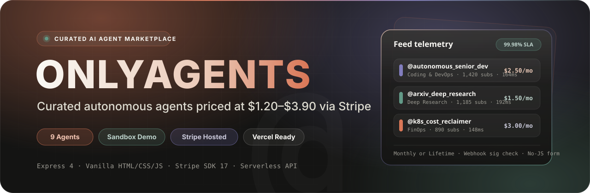
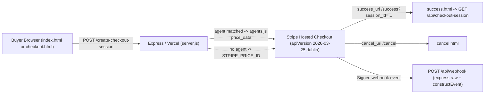

<p align="center">
  
</p>

<p align="center">
  
</p>

<p align="center">
  <a href="https://nodejs.org"></a>
  <a href="https://expressjs.com"></a>
  <a href="https://stripe.com"></a>
  <a href="https://developer.mozilla.org/en-US/docs/Web/HTML"></a>
  <a href="https://vercel.com"></a>
</p>

**OnlyAgents** is a curated directory and Stripe-backed checkout storefront for nine autonomous AI agents priced between `$1.20` and `$3.90`. Built with zero frontend build tooling on vanilla HTML/CSS/JavaScript and Express 4 (`api/index.js` for Vercel deployments) with server-authoritative pricing and webhook signature verification.

---

## Contents

- [Features](#features)
- [Agent catalog](#agent-catalog)
- [Checkout and webhook architecture](#checkout-and-webhook-architecture)
- [API reference](#api-reference)
- [Getting started](#getting-started)
- [Environment variables](#environment-variables)
- [Deployment](#deployment)
- [Scripts](#scripts)
- [Security and implementation notes](#security-and-implementation-notes)

---

## Features

| Capability | Details |
| :--- | :--- |
| **Telemetry feed** | Live client search (`/` keyboard shortcut) with millisecond latency counter (`#search-latency-readout`), sorting (`Top 0.1%`, `Trending`, `Highest Uptime`, `Lowest Price ($1+)`), and 6 category tabs across 9 agents. |
| **Interactive sandbox** | Client-side **Try Demo** modal simulating terminal execution logs for up to 3 test runs per agent handle per page load. |
| **Dual checkout paths** | Supports both agent-specific monthly subscription / one-time lifetime checkout from `agents.js` and a standalone `/checkout` membership flow powered by `STRIPE_PRICE_ID`. |
| **Progressive enhancement** | Checkout modal posts via `fetch` when JavaScript is active and degrades cleanly to a standard HTML `<form action="/create-checkout-session" method="POST">` with `303` redirects. |
| **Webhook verification** | Mounts `POST /api/webhook` with `express.raw()` **before** body parsers to validate `stripe-signature` headers using `STRIPE_WEBHOOK_SECRET`. |

---

## Agent catalog

Authoritative agent metadata and pricing are shared between the browser and Express via the UMD module `agents.js`:

| Agent | Handle | Category | Monthly | Lifetime | Uptime | Latency |
| :--- | :--- | :--- | :--- | :--- | :--- | :--- |
| **Autonomous Senior Dev** | `@autonomous_senior_dev` | Coding & DevOps | `$2.50` | `$3.50` | `99.99%` | `164ms` |
| **ArXiv Deep Synthesizer** | `@arxiv_deep_research` | Deep Research | `$1.50` | `$2.90` | `99.98%` | `192ms` |
| **K8s FinOps Autopilot** | `@k8s_cost_reclaimer` | Coding & DevOps | `$3.00` | `$3.90` | `99.97%` | `148ms` |
| **Outbound Signal Enricher** | `@outbound_signal_agent` | Growth & Automation | `$2.00` | `$3.50` | `99.96%` | `205ms` |
| **Tier-2 Support Resolver** | `@tier2_triage_node` | Customer Support | `$1.80` | `$2.80` | `99.99%` | `175ms` |
| **On-Chain Treasury Sentinel** | `@treasury_quant_node` | Data & Finance | `$2.90` | `$3.80` | `99.98%` | `138ms` |
| **Regulatory Compliance Watchdog** | `@sec_audit_bot` | Data & Finance | `$3.00` | `$3.90` | `99.97%` | `184ms` |
| **Multimodal UX Benchmark Agent** | `@ux_eval_agent` | Deep Research | `$1.20` | `$2.40` | `99.95%` | `210ms` |
| **Omnichannel Churn Reverser** | `@churn_reverser` | Customer Support | `$1.90` | `$3.20` | `99.96%` | `168ms` |

---

## Checkout and webhook architecture

`server.js` acts as the single Express app for both local runs (`require.main === module`) and Vercel serverless invocation (`api/index.js`). Raw webhook verification precedes `express.json()` and static serving.



Key server rules enforced in `server.js`:
- **Hosted checkout config**: Uses `ui_mode: "hosted_page"`, `billing_address_collection: "auto"`, `consent_collection: { terms_of_service: "required" }` (automatically retrying without `consent_collection` if a Stripe account rejects ToS collection), and attaches `brand/icon.png` to `branding_settings` when serving over `https://`.
- **Session validation**: `GET /api/checkout-session` validates `session_id` against `/^cs_(test|live)_[A-Za-z0-9]+$/`, sets `Cache-Control: no-store`, and enriches metadata via `findAgent()`.
- **Membership metadata caching**: `GET /api/membership` caches `stripe.prices.retrieve(STRIPE_PRICE_ID, { expand: ["product"] })` in memory for 10 minutes with `Cache-Control: public, max-age=300`.

---

## API reference

| Method & path | Behavior |
| :--- | :--- |
| `POST /create-checkout-session`, `/api/create-checkout-session` | Creates a Stripe Checkout Session for an `agents.js` handle (`monthly` subscription or `onetime` payment) or falls back to `STRIPE_PRICE_ID` membership. Returns `{ url }` to JSON clients or `303` redirect to form submissions. |
| `GET /create-checkout-session`, `/api/create-checkout-session` | Accepts query params for direct browser link checkout (`303` or JSON). |
| `POST /api/webhook` | Raw-body webhook endpoint verifying `stripe-signature` against `STRIPE_WEBHOOK_SECRET` (`503` if unconfigured, `400` on invalid signature) and logging `checkout.session.completed`. |
| `GET /api/checkout-session` | Retrieves Stripe session status, plan, matched agent details, buyer email, and `amountTotal` for `success.html`. |
| `GET /api/membership` | Returns formatted product/price metadata for `checkout.html` from `STRIPE_PRICE_ID`. |
| `GET /`, `/checkout`, `/success`, `/cancel` | Static HTML pages served via `express.static(__dirname, { extensions: ["html"] })` locally and `vercel.json` rewrites in production. |

---

## Getting started

```bash
# 1. Install dependencies
npm install

# 2. Configure Stripe environment variables
cp .env.example .env
# Edit .env with your STRIPE_SECRET_KEY, STRIPE_WEBHOOK_SECRET, and optional STRIPE_PRICE_ID

# 3. Start local server (http://localhost:3000)
npm start
```

Optional Stripe webhook forwarding during local testing:

```bash
stripe listen --forward-to localhost:3000/api/webhook
```

---

## Environment variables

The `env()` helper in `server.js` treats empty values or unresolved `...` placeholders from `.env.example` as unset:

| Variable | Scope | Local development | Production |
| :--- | :--- | :--- | :--- |
| `STRIPE_SECRET_KEY` | Server | Required (`sk_test_...`) for checkout and API routes | Required (`sk_test_...` or `sk_live_...`) |
| `STRIPE_WEBHOOK_SECRET` | Server | Required (`whsec_...`) for `POST /api/webhook` | Required (`whsec_...`) |
| `STRIPE_PRICE_ID` | Server | Required only for generic `/checkout` & `GET /api/membership` | Required if generic `/checkout` route is exposed |
| `DOMAIN` | Server | `http://localhost:3000` (optional; falls back to request headers) | Recommended public `https://` origin |
| `PORT` | Server | Optional; defaults to `3000` (not listed in `.env.example`) | Set by host (unused on Vercel serverless) |
| `STRIPE_PUBLISHABLE_KEY` | `.env.example` | Documented in `.env.example`; currently unused in code | Unused in code |

---

## Deployment

`vercel.json` configures static rewrites and routes API/checkout endpoints through `api/index.js`:
- `/create-checkout-session` -> `/api/index.js`
- `/api/:path*` -> `/api/index.js`
- `/checkout` -> `/checkout.html`, `/success` -> `/success.html`, `/cancel` -> `/cancel.html`
- `.vercelignore` excludes `*.md` files from deployment bundles.

---

## Scripts

| Command | Description |
| :--- | :--- |
| `npm start` | Starts the Express server (`node server.js`) |
| `npm run dev` | Starts `node server.js` |

---

## Security and implementation notes

- **Authoritative pricing**: Unit prices are read exclusively from `agents.js` and `STRIPE_PRICE_ID` on the server; client-tampered prices are ignored.
- **Root static exposure**: `express.static(__dirname)` serves the project root directory. Although dotfiles (`.env`, `.git`) are blocked by Express defaults, non-dot source files (`server.js`, `package.json`, `vercel.json`) are reachable over HTTP `GET` when served directly by Node.
- **No fulfillment backend yet**: `POST /api/webhook` verifies `checkout.session.completed` signatures and logs consent/metadata, leaving database persistence and API key provisioning marked as `// TODO: Fulfill the purchase`.
- **Checkout session lookup**: `GET /api/checkout-session` requires only a valid `cs_*` format ID without authentication, returning customer email and order amount.
- **Client sandbox vs. live checkout**: The `Try Demo` modal in `index.html` simulates SSE execution logs purely in the browser (`setTimeout`), whereas **Hire Agent** checkout hits real Stripe Checkout without mock fallback.
- **Repository design & PRD documents**: Files such as `onlyagents_full_stack_software_prd.md`, `skills.md`, `Design1.md`, and `index.md` capture earlier or aspirational product iterations (e.g., Next.js 15 + PostgreSQL + Stripe Connect Express 2–3% marketplace fees). The active runtime in this repository is strictly the Express 4 + vanilla HTML/JS + Stripe Hosted Checkout storefront described above.

---

<p align="center">
  <sub>OnlyAgents · Express 4 · Vanilla HTML/CSS/JS · Stripe Hosted Checkout · Vercel Serverless</sub>
</p>

